# Modelo de datos — PetLove (v1, Hito 2)

Primera versión del modelo de datos de la Aplicación Backend de PetLove. El modelo se construyó a partir de los contratos de la API (DTOs documentados en OpenAPI/Swagger) y se normalizó hasta la tercera forma normal (3NF).

| | |
|---|---|
| **Motor** | MySQL 8 (contenedor `petlove-db`, definido en `compose.yaml`) |
| **Tablas** | 28, organizadas en 3 módulos |
| **Estado** | Modelo definido. En este hito los servicios funcionan con almacenamiento en memoria (dummy); la conexión a la base de datos (TypeORM) y los scripts de estructura y datos de prueba se incorporarán en el Hito 3. |

## Convenciones

- **Nombres** de tablas y columnas en `snake_case` (`fecha_nacimiento`, `correo_electronico`). Se mapean a los nombres `camelCase` de los DTOs al implementar las entidades con TypeORM.
- **Identificadores** de las entidades principales como UUID (`varchar(36)`), igual que los `id` de tipo `string` que expone la API. Los catálogos pequeños (especies, especialidades, categorías, cupones) usan `int` autoincremental.
- **Claves**: `PK` clave primaria, `FK` clave foránea, `UK` clave única. Cuando dos columnas aparecen marcadas como `PK`, forman una **única clave primaria compuesta**.
- **Cardinalidad** en notación pata de gallo: `||` exactamente uno, `o|` cero o uno, `|{` uno o muchos, `o{` cero o muchos.

## Diagrama entidad-relación

```mermaid
erDiagram
    %% ===================== MÓDULO USUARIOS =====================
    usuarios {
        varchar id PK "UUID"
        varchar nombre
        varchar apellidos
        date fecha_nacimiento
        varchar correo_electronico UK
        varchar password_hash
        enum rol "DUENIO, VETERINARIO, ADMIN"
        datetime created_at
    }

    veterinarios {
        varchar usuario_id PK, FK
        int experiencia_anios
        varchar descripcion
    }

    especialidades {
        int id PK
        varchar nombre UK
    }

    veterinario_especialidades {
        varchar veterinario_id PK, FK
        int especialidad_id PK, FK
    }

    especies {
        int id PK
        varchar nombre UK "Perro, Gato, Ave..."
    }

    veterinario_especies {
        varchar veterinario_id PK, FK
        int especie_id PK, FK
    }

    direcciones {
        varchar id PK "UUID"
        varchar usuario_id FK
        varchar direccion
        varchar departamento_oficina
        varchar comuna
        varchar region
        varchar referencia
        boolean es_predeterminada
    }

    usuarios ||--o| veterinarios : "es"
    usuarios ||--o{ direcciones : "tiene"
    veterinarios ||--o{ veterinario_especialidades : "tiene"
    especialidades ||--o{ veterinario_especialidades : "asignada a"
    veterinarios ||--o{ veterinario_especies : "atiende"
    especies ||--o{ veterinario_especies : "atendida por"

    %% ============ MÓDULO MASCOTAS Y GESTIÓN CLÍNICA ============
    mascotas {
        varchar id PK "UUID"
        varchar duenio_id FK
        int especie_id FK
        varchar nombre
        varchar raza
        date fecha_nacimiento
        decimal peso_kg
        enum sexo "MACHO, HEMBRA"
        varchar foto_url
        varchar descripcion
    }

    mascota_alergias {
        int id PK
        varchar mascota_id FK
        varchar descripcion
    }

    mascota_enfermedades {
        int id PK
        varchar mascota_id FK
        varchar descripcion
    }

    servicios {
        varchar id PK "UUID"
        int especie_id FK
        varchar nombre
        varchar descripcion
        varchar marca
        decimal precio
        decimal descuento
        int cantidad
        varchar rango_edad
        varchar ficha_tecnica
        varchar consejos_salud
    }

    citas {
        varchar id PK "UUID"
        varchar mascota_id FK
        varchar veterinario_id FK
        datetime fecha_cita
    }

    cita_servicios {
        varchar cita_id PK, FK
        varchar servicio_id PK, FK
    }

    consultas {
        varchar id PK "UUID"
        varchar mascota_id FK
        varchar veterinario_id FK
        datetime fecha_consulta
        varchar diagnostico
        date fecha_prox_consulta
        date fecha_prox_vacuna
        date fecha_prox_examenes
    }

    recetas {
        varchar id PK "UUID"
        varchar consulta_id FK, UK
        varchar dosis
        varchar frecuencia
        varchar duracion
        date fecha_emision
    }

    receta_productos {
        varchar receta_id PK, FK
        varchar producto_id PK, FK
    }

    ordenes_examen {
        varchar id PK "UUID"
        varchar consulta_id FK
        date fecha_emision
    }

    examenes {
        varchar id PK "UUID"
        varchar orden_id FK
        varchar nombre_examen
        varchar resultado
        varchar estado
    }

    usuarios ||--o{ mascotas : "es duenio de"
    especies ||--o{ mascotas : "clasifica"
    mascotas ||--o{ mascota_alergias : "tiene"
    mascotas ||--o{ mascota_enfermedades : "tiene"
    especies ||--o{ servicios : "dirigido a"
    mascotas ||--o{ citas : "tiene"
    veterinarios ||--o{ citas : "atiende"
    citas ||--|{ cita_servicios : "incluye"
    servicios ||--o{ cita_servicios : "agendado en"
    mascotas ||--o{ consultas : "recibe"
    veterinarios ||--o{ consultas : "realiza"
    consultas ||--o| recetas : "emite"
    recetas ||--|{ receta_productos : "prescribe"
    consultas ||--o{ ordenes_examen : "solicita"
    ordenes_examen ||--o{ examenes : "contiene"

    %% ============ MÓDULO CATÁLOGO, CARRITO Y PEDIDOS ============
    categorias {
        int id PK
        varchar nombre UK
        int categoria_padre_id FK "nulo si es categoria principal"
    }

    productos {
        varchar id PK "UUID"
        varchar sku UK
        varchar nombre
        varchar descripcion
        varchar marca
        int categoria_id FK
        int especie_id FK
        decimal precio
        decimal precio_original
        int stock
        int cantidad
        varchar rango_edad
        varchar material
        varchar ficha_tecnica
        varchar modo_de_uso
        json ficha_tecnica_detalle
    }

    producto_imagenes {
        int id PK
        varchar producto_id FK
        varchar url
        int orden
    }

    resenas {
        varchar id PK "UUID"
        varchar producto_id FK
        varchar usuario_id FK
        int calificacion "1 a 5"
        varchar titulo
        varchar comentario
        datetime fecha
    }

    cupones {
        int id PK
        varchar codigo UK
        enum tipo_descuento "PORCENTAJE, MONTO"
        decimal valor
        date fecha_inicio
        date fecha_fin
        boolean activo
    }

    carritos {
        varchar id PK "UUID"
        varchar usuario_id FK, UK "nulo si es invitado"
        int cupon_id FK
        datetime updated_at
    }

    carrito_items {
        varchar carrito_id PK, FK
        varchar producto_id PK, FK
        int cantidad
    }

    pedidos {
        varchar id PK "UUID"
        varchar usuario_id FK "nulo si es invitado"
        int cupon_id FK
        varchar nombre
        varchar apellidos
        varchar correo_electronico
        varchar telefono
        enum tipo_comprobante "Boleta, Factura"
        varchar rut_documento
        enum tipo_entrega "EnvioNormal, RetiroEnTienda"
        varchar direccion
        varchar departamento_oficina
        varchar comuna
        varchar region
        varchar referencia
        varchar sucursal_retiro
        enum metodo_pago "MercadoPago, Tarjeta, WebpayPlus"
        boolean acepta_terminos
        decimal costo_envio
        decimal descuento
        enum estado "ver seccion Pedidos"
        datetime fecha_creacion
    }

    pedido_items {
        varchar pedido_id PK, FK
        varchar producto_id PK, FK
        int cantidad
        decimal precio_unitario "precio al momento de la compra"
    }

    pedido_historial_estados {
        int id PK
        varchar pedido_id FK
        varchar estado
        datetime fecha
    }

    categorias |o--o{ categorias : "contiene"
    categorias ||--o{ productos : "agrupa"
    especies ||--o{ productos : "dirigido a"
    productos ||--|{ producto_imagenes : "tiene"
    productos ||--o{ resenas : "recibe"
    usuarios ||--o{ resenas : "escribe"
    productos ||--o{ receta_productos : "prescrito en"
    usuarios |o--o| carritos : "tiene"
    cupones |o--o{ carritos : "aplicado en"
    carritos ||--o{ carrito_items : "contiene"
    productos ||--o{ carrito_items : "agregado en"
    usuarios |o--o{ pedidos : "realiza"
    cupones |o--o{ pedidos : "aplicado en"
    pedidos ||--|{ pedido_items : "incluye"
    productos ||--o{ pedido_items : "vendido en"
    pedidos ||--|{ pedido_historial_estados : "registra"
```

## Descripción por módulo

### Usuarios

| Tabla | Descripción | Tipo |
|---|---|---|
| `usuarios` | Datos comunes de dueños, veterinarios y administradores. El `rol` los distingue. | Entidad principal |
| `veterinarios` | Datos profesionales que solo tiene un veterinario. | Extensión 1:1 de `usuarios` |
| `direcciones` | Direcciones de cada usuario, con una marcada como predeterminada. | 1:N con `usuarios` |
| `especialidades` | Catálogo de especialidades veterinarias. | Catálogo |
| `especies` | Catálogo de especies, compartido por mascotas, veterinarios, servicios y productos. | Catálogo |
| `veterinario_especialidades` | Especialidades de cada veterinario. | Tabla intermedia N:M |
| `veterinario_especies` | Especies que atiende cada veterinario. | Tabla intermedia N:M |

### Mascotas y gestión clínica

| Tabla | Descripción | Tipo |
|---|---|---|
| `mascotas` | Datos de cada mascota y su dueño. | Entidad principal |
| `mascota_alergias` | Alergias de cada mascota. | 1:N con `mascotas` |
| `mascota_enfermedades` | Enfermedades existentes de cada mascota. | 1:N con `mascotas` |
| `servicios` | Servicios que ofrece la clínica. | Catálogo |
| `citas` | Horas agendadas de una mascota con un veterinario. | Entidad principal |
| `cita_servicios` | Servicios incluidos en cada cita. | Tabla intermedia N:M |
| `consultas` | Atención clínica: diagnóstico y próximas fechas de control. | Entidad principal |
| `recetas` | Receta emitida en una consulta (como máximo una por consulta). | 1:0..1 con `consultas` |
| `receta_productos` | Productos del catálogo prescritos en cada receta. | Tabla intermedia N:M |
| `ordenes_examen` | Órdenes de examen solicitadas en una consulta. | 1:N con `consultas` |
| `examenes` | Exámenes de cada orden, con su resultado y estado. | 1:N con `ordenes_examen` |

### Catálogo, carrito y pedidos

| Tabla | Descripción | Tipo |
|---|---|---|
| `categorias` | Categorías y subcategorías (jerarquía mediante `categoria_padre_id`). | Catálogo jerárquico |
| `productos` | Productos a la venta, con precio y stock. | Entidad principal |
| `producto_imagenes` | Imágenes de cada producto (al menos una). | 1:N con `productos` |
| `resenas` | Opiniones de usuarios sobre productos. | Entidad |
| `cupones` | Códigos de descuento. | Catálogo |
| `carritos` | Carrito actual de cada usuario o invitado. | Entidad principal |
| `carrito_items` | Productos y cantidades en cada carrito. | Tabla intermedia N:M |
| `pedidos` | Compras realizadas, con datos de contacto, entrega y pago. | Entidad principal |
| `pedido_items` | Productos comprados, con cantidad y precio pagado. | Tabla intermedia N:M con datos propios |
| `pedido_historial_estados` | Historial de estados de cada pedido (seguimiento). | 1:N con `pedidos` |

**Estados del pedido** (propuesta, a acordar con Frontend y Mobile): `PENDIENTE`, `PAGADO`, `EN_PREPARACION`, `ENVIADO`, `ENTREGADO`, `CANCELADO`.

## Decisiones de diseño

### Primera forma normal (1NF): un valor por celda

Varios DTOs de la API contienen listas (`string[]`). Como una celda no puede almacenar una lista, cada una se representa como una tabla:

| Campo en la API | Representación en el modelo |
|---|---|
| `veterinario.especialidad[]` | `especialidades` + `veterinario_especialidades` (N:M) |
| `veterinario.especieAtendida[]` | `especies` + `veterinario_especies` (N:M) |
| `mascota.alergias[]` | `mascota_alergias` (1:N) |
| `mascota.enfermedadesExistentes[]` | `mascota_enfermedades` (1:N) |
| `cita.serviciosAdicionales[]` | `cita_servicios` (N:M) |
| `producto.imagenes[]` | `producto_imagenes` (1:N) |
| `receta.productosPrescritosIds[]` | `receta_productos` (N:M) |
| `seguimiento.historialPasos[]` | `pedido_historial_estados` (1:N) |

### Segunda forma normal (2NF): dependencia de la clave completa

Las tablas intermedias usan una clave primaria compuesta por las dos claves foráneas, por ejemplo `PRIMARY KEY (veterinario_id, especialidad_id)`. Ninguna de las dos columnas identifica la fila por sí sola, pero su combinación sí, y además impide registrar dos veces la misma asociación. Solo se agregan atributos a una tabla intermedia cuando dependen de la combinación completa, como `cantidad` y `precio_unitario` en `pedido_items`.

### Tercera forma normal (3NF): sin dependencias transitivas

- **`citas` no almacena el dueño.** Aunque `CreateCitaDto` recibe `duenioId`, el dueño se obtiene a través de la mascota (cita → mascota → dueño).
- **`resenas` no almacena el nombre del usuario.** `nombreUsuario` se obtiene desde `usuarios`.
- **`usuarios` no almacena una dirección en texto.** Las direcciones se gestionan en `direcciones`.
- **`consultas` no almacena `recetaId`.** La relación se registra solo en `recetas.consulta_id`.
- **`productos` apunta solo a su categoría más específica.** La categoría principal se obtiene mediante `categoria_padre_id`.
- **`especies` es un catálogo compartido**, para evitar que una misma especie quede escrita de distintas formas.

### Relaciones 1:1 y uso de claves únicas

- **`veterinarios`** usa `usuario_id` como clave primaria y foránea a la vez. Así, el `veterinarioId` de la API corresponde al id del usuario, y la relación 1:1 queda garantizada por la estructura. Además, como las tablas intermedias referencian a `veterinarios`, solo un usuario veterinario puede tener especialidades.
- **`recetas.consulta_id` (FK, UK)** limita a una receta por consulta, según `GetConsultaDto`.
- **`carritos.usuario_id` (FK, UK, nulo permitido)** limita a un carrito por usuario y permite carritos de invitados.

### Campos calculados (no se almacenan)

Los siguientes campos existen en los DTOs de respuesta, pero el Backend los calcula al consultar, para evitar que queden desactualizados:

| Campo | Se calcula a partir de |
|---|---|
| `edad` (dueños, veterinarios, mascotas) | `fecha_nacimiento` |
| `calificacionPromedio`, `totalResenas` | `resenas` |
| `subtotal`, `total`, `totalArticulos` (carrito y pedido) | Ítems, cupón y costo de envío |
| `descuento` del producto | `precio_original` y `precio` |
| `subtotal` de cada ítem | `precio` × `cantidad` |

### Excepciones conscientes

- **Datos históricos del pedido.** `pedidos` copia el nombre, contacto y dirección de entrega, y `pedido_items` guarda el `precio_unitario`. No es redundancia: el pedido es un registro del momento de la compra, que no debe cambiar si después el usuario actualiza sus datos o el producto cambia de precio. Además, `CreatePedidoDto` permite comprar sin cuenta (`usuarioId` opcional), por lo que un invitado no tiene usuario ni direcciones de donde obtener esos datos.
- **`pedidos.estado`.** El estado actual también podría obtenerse desde el último registro de `pedido_historial_estados`. Se mantiene en `pedidos` para consultar de forma directa los pedidos por estado (desnormalización por rendimiento), lo que exige mantener ambos sincronizados.

## Mejoras identificadas para el Hito 3

1. **Indicaciones por producto en recetas (2NF).** Hoy `dosis`, `frecuencia` y `duracion` están en `recetas`, por lo que todos los productos de una receta comparten las mismas indicaciones. Como dependen de la combinación receta + producto, se trasladarán a `receta_productos`. Requiere ajustar `CreateRecetaDto` para que cada producto prescrito incluya sus indicaciones.
2. **Catálogo de alergias y enfermedades.** Hoy se registran como texto libre (1:N), lo que permite que un mismo concepto quede escrito de distintas formas y dificulta las búsquedas. Se reemplazarán por catálogos (`alergias`, `enfermedades`) con tablas intermedias N:M hacia `mascotas`, siguiendo el criterio aplicado a `especies`. Requiere ajustar `CreateMascotaDto`.
3. **Atributos propios de servicios.** `servicios` replica atributos de productos que no aplican a un servicio (`marca`, `cantidad`, `ficha_tecnica`). Se redefinirá con atributos propios (tipo de servicio, `duracion_minutos`, `requiere_veterinario`), y la relación con `especies` pasará a ser N:M (`servicio_especies`), ya que un servicio puede aplicar a varias especies. Requiere ajustar `CreateServicioDto`.

Además, en el Hito 3 se implementarán las entidades con TypeORM, la conexión al contenedor MySQL y los scripts de estructura inicial y datos de prueba.
